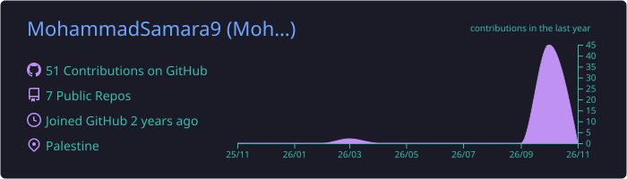
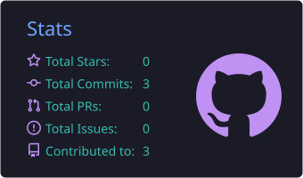
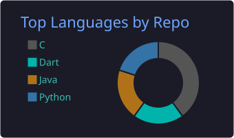

<!-- ====================== HEADER ====================== -->

  

  

  
  
  
  

<!-- ====================== ABOUT ====================== -->
## 👨‍💻 About Me

I'm a **Computer Engineering student at Birzeit University** who enjoys the space where **hardware meets AI**.
I started with C, data structures and digital design, and now I'm building my way into **AI agents** with the **Claude API**.

- 🔭 **Now:** learning the Claude API and building my first AI agents
- 🌱 **Next:** Edge AI & TinyML, running AI on small devices
- 🧠 **Strong in:** C, Data Structures & Algorithms, OOP
- 🛠️ **How I learn:** one small project for every topic, documented on GitHub
- 🎯 **Goal:** build AI-powered systems that solve real-world problems

 

<!-- ====================== TECH STACK ====================== -->
## 🧰 Tech Stack

<table>
  <tr>
    <td align="center" width="150"><b>Languages</b></td>
    <td></td>
  </tr>
  <tr>
    <td align="center"><b>Hardware & Low-level</b></td>
    <td>
      
      
    </td>
  </tr>
  <tr>
    <td align="center"><b>Tools</b></td>
    <td></td>
  </tr>
  <tr>
    <td align="center"><b>AI</b></td>
    <td>
      
      
      
      
    </td>
  </tr>
  <tr>
    <td align="center"><b>Computer Science</b></td>
    <td>
      
      
      
    </td>
  </tr>
</table>

<!-- ====================== PROJECTS ====================== -->
## 🚀 Featured Projects

<table>
  <tr>
    <td width="50%" valign="top">
      <h3>🤖 <a href="https://github.com/MohammadSamara9/agents-learning">agents-learning</a></h3>
      My hands-on journey to <b>AI agents & multi-agent systems</b>, with a roadmap, a learning log and a project for every step.
        
      
      
      
    </td>
    <td width="50%" valign="top">
      <h3>🌳 <a href="https://github.com/MohammadSamara9/data-structures-in-c">data-structures-in-c</a></h3>
      <b>3 course projects</b> (task managers with lists, stacks and BSTs, and a road network MST with Prim & Kruskal), lecture examples and <b>23 solved problems</b>.
        
      
      
    </td>
  </tr>
  <tr>
    <td width="50%" valign="top">
      <h3>☕ <a href="https://github.com/MohammadSamara9/java-practice">java-practice</a></h3>
      Java basics, <b>OOP</b> (inheritance, polymorphism, abstraction) and a <b>Clinic Management System</b>.
        
      
    </td>
    <td width="50%" valign="top">
      <h3>📘 <a href="https://github.com/MohammadSamara9/C-Learning-Journey">C-Learning-Journey</a></h3>
      C exercises from pointers to file handling, plus a <b>Bookstore Management</b> project.
        
      
    </td>
  </tr>
  <tr>
    <td width="50%" valign="top">
      <h3>🐍 <a href="https://github.com/MohammadSamara9/python-learning">python-learning</a></h3>
      Python basics, OOP and small projects like a phone directory.
        
      
    </td>
    <td width="50%" valign="top">
      <h3>🎯 <a href="https://github.com/MohammadSamara9/dart-learning">dart-learning</a></h3>
      Dart basics, OOP, async/await and small console apps.
        
      
    </td>
  </tr>
</table>

<!-- ====================== CERTIFICATES ====================== -->
## 🎓 Certificates

| Certificate | Issuer | Date | |
|---|---|---|---|
| Claude 101 | Claude Academy (Anthropic) | Oct 2026 | [Verify](https://academy.claude.com/verify/b0de2c3808f48a5303c4142cd1417cfe) |
| Data Structures in C | University of Michigan · Coursera | Sep 2026 | [Verify](https://coursera.org/verify/3QDQB877TGOU) |
| Python Bootcamp for Beginners | Udemy | Sep 2026 | [Verify](https://ude.my/UC-9c0e5aca-caa0-4783-a99a-4b30d90af734) |
| Programming in C | University of Michigan · Coursera | Jul 2025 | [Verify](https://coursera.org/verify/P6J5Q6XLLX0P) |
| Exploring C | University of Michigan · Coursera | Jun 2025 | [Verify](https://coursera.org/verify/HUHF5FEMJKLO) |

<!-- ====================== STATS ====================== -->
## 📊 GitHub Stats

  

  
  

  

<!-- ====================== FOOTER ====================== -->

  

